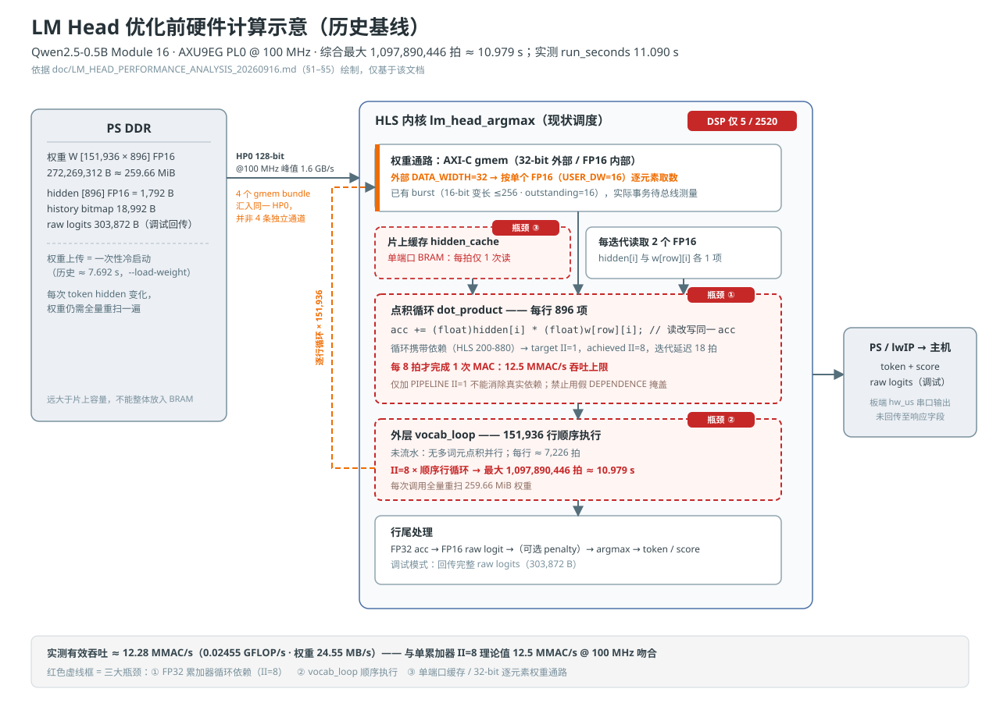
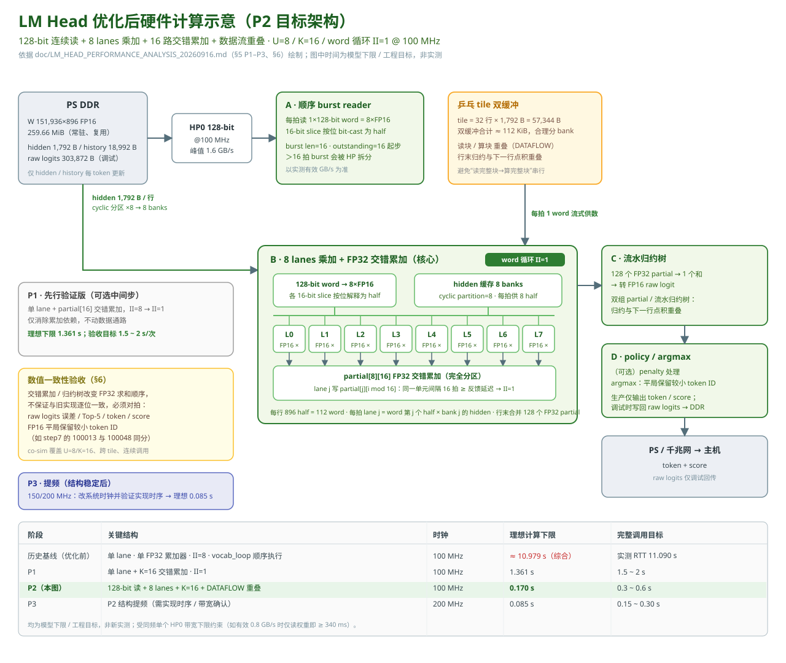

# LM Head 硬件计算示意图（优化前 / 优化后）

绘制日期：2026-09-16。
唯一依据：`doc/LM_HEAD_PERFORMANCE_ANALYSIS_20260916.md`（按要求，未参考 doc 目录中其他文件）。

## 文件

| 文件 | 内容 |
|---|---|
| `LM_HEAD_HW_DIAGRAM_BEFORE_20260916.svg` | 优化前（历史基线）硬件计算结构 |
| `LM_HEAD_HW_DIAGRAM_AFTER_20260916.svg` | 优化后（P2 目标架构，附 P1/P3 路标）硬件计算结构 |
| `LM_HEAD_HW_DIAGRAMS_20260916.html` | 自包含 HTML 展示页（5 个标签页：优化前 / 优化后 / 结构对照 / 计算量与拍数分析 / 执行过程交互演示，可离线打开） |

用浏览器打开 SVG 或 HTML 即可查看；本页下方为嵌入图与结构对照。

## 优化前（历史基线：单累加器，II=8，约 10.979 s @ 100 MHz）

- 权重 151,936×896 FP16（259.66 MiB）常驻 DDR，每次 token 全量重扫；4 个 gmem bundle 汇入同一 HP0（128-bit @100 MHz，峰值 1.6 GB/s）。
- 权重通路外部 32-bit、按单个 FP16 逐元素取数（已有 burst）。
- 点积循环依赖单个 FP32 累加器，achieved II=8，每 8 拍才完成 1 次 MAC（12.5 MMAC/s 上限，与实测 12.28 MMAC/s 吻合）。
- vocab_loop 对 151,936 行顺序执行、未流水，约 7,226 拍/行，综合最大 1,097,890,446 拍 ≈ 10.979 s；实测 run_seconds 11.090 s。
- DSP 仅用 5/2520：低占用反映并行度低。

## 优化后（P2 目标架构：128-bit 读 + 8 lanes + 交错累加 + 数据流，理想 0.170 s @ 100 MHz）

- 数据流分四个可重叠阶段：A 顺序 burst reader（每拍 1×128-bit word）→ 乒乓 tile 双缓冲（32 行 ≈112 KiB）→ B 8 lanes 乘加 + partial[8][16] FP32 交错累加（word 循环 II=1）→ C 流水归约树 → D penalty/argmax。
- 依赖消除：lane j 只写 partial[j][i mod 16]，同一单元间隔 16 拍 ≥ 反馈延迟，从而达成 II=1。
- hidden 缓存按 cyclic partition ×8 分成 8 banks，每拍供 8 个 half，与 8×FP16 权重对齐。
- 数值一致性是验收条件：交错累加/归约树改变 FP32 求和顺序，须与基线对拍，FP16 平局保留较小 token ID。
- P3 在结构稳定后提频 150/200 MHz（需实现时序与带宽验证），理想下限 0.085 s。

## 结构对照

| 维度 | 优化前 | 优化后（P2） |
|---|---|---|
| 点积内层 | 单 FP32 累加器，II=8 | 8 lanes × partial[8][16] 交错累加，II=1 |
| 权重通路 | 32-bit 外部端口逐元素取 FP16 | 128-bit 连续 burst，每拍 8×FP16（bit-cast） |
| hidden 缓存 | 单端口 BRAM | 8 banks（cyclic partition=8） |
| 阶段组织 | 读/算/行尾顺序串行 | reader / MAC / 归约 / policy 数据流重叠 |
| 时间（理想下限） | ≈10.979 s @100 MHz | 0.170 s @100 MHz；0.085 s @200 MHz（P3） |

## 计算量与拍数分析（补充）

### 理论计算量（每次 RUN_TOKEN，与实现方式无关）

- 乘法（FP16×FP16→FP32）：151,936 × 896 = **136,134,656 次**。
- 加法（累加，一乘一加口径）：**136,134,656 次**；严格必需为每行 895 次 → 135,982,720 次（推算）。
- 合计 ≈ 272.27 MFLOP（文档口径）。
- 行末归并附加加法（推算）：基线 0；P1 每行 15 次 → 2,279,040 次（串行 +≈0.023 s）；P2 每行 127 次 → 19,295,872 次（若串行 +≈0.193 s @100 MHz，必须流水归约 / 双组 partial 与下一行重叠）。

### 访存量（每次 RUN_TOKEN）

- DDR 读：权重 **272,269,312 B ≈ 259.66 MiB**（所有方案相同）；hidden 1,792 B；history 18,992 B。
- DDR 写：raw logits 303,872 B（调试）；生产仅 token/score。
- 片上：hidden 元素读 136,134,656 次（每 MAC 1 次；基线/P1 单端口每拍 1 次，P2 分 8 bank 每拍 8 次）。

### 各实现方式拍数（cycle 数；100 MHz，P3 为 200 MHz）

| 方案 | 每行点积拍数 | 总拍数 | 时间 | 吞吐 |
|---|---|---:|---:|---:|
| 基线（II=8） | 896×8 = 7,168（行开销 ≈+58，推算） | 1,097,890,446（综合最大） | 10.979 s | 12.5 MMAC/s |
| P1（II=1） | 896（+归并 15） | 136,134,656 + ≈2,279,040 | 1.361 s | 100 MMAC/s |
| P2 | 112（= 896÷8） | 17,016,832 | 0.170 s | 800 MMAC/s |
| P3 @200 MHz | 112 | 8,508,416 | 0.085 s | 1,600 MMAC/s |

权重供给拍数下限（推算）= 272,269,312 B ÷ 每拍有效字节数：2 B/拍 → 136,134,656 拍（1.361 s）；4 B/拍（32-bit 端口）→ 68,067,328 拍（0.681 s）；16 B/拍 @100 MHz → 17,016,832 拍（0.170 s）；@200 MHz → 8,508,416 拍（0.085 s）。P2 的计算拍数与 128-bit HP0 理论带宽拍数恰好相等（双下限重合），实效带宽决定成败（0.8 GB/s → 340 ms）。

## 说明与限制

- 图中数值引自上述分析文档，均为模型下限或工程目标，不是新的实测结果。
- 优化后结构尚未综合验证（文档中 P1 代码为概念示意）；实施前需按文档 §5/§6 完成综合、co-sim 与板上对拍。
- 同频单个 HP0 的带宽下限必须同时满足（如有效 0.8 GB/s 时仅读权重即 ≥340 ms）。
