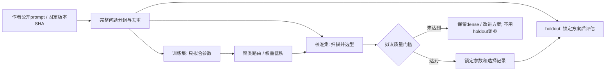

# lm_head v4 · 离线实施与下一道验收门槛

日期：2026-10-21。当前继续 [原规划](LM_HEAD_V4_PLAN_20261019.md)，由主模型本地执行。
PL DDR dense 迁移已经由 v3.1完成；本轮不重复实现、不操作FPGA，不恢复旧任务或心跳。
最新进度见 [PROGRESS.json](../module_14_lm_head_v4/PROGRESS.json)。

## 已有可复核结果

| 项目 | 结论与范围 | 证据 |
| --- | --- | --- |
| v3.1 基线 | 200MHz，IP median117.751830ms，等效8.4924 token/s；仅lm_head | [BASELINE](../module_14_lm_head_v4/BASELINE.json) |
| 候选原行精算 | 8步×6组=48组：全表、2K/4K/8K/16K、边界ID；raw/penalty FP32 bits一致 | [CPU真实回归](../module_14_lm_head_v4/reports/candidate_smoke_20261021/RESULT.json) |
| CUDA标签基准 | 8步完整raw及processed SHA与已验收golden相同；非普通GEMM | [GPU基准](../module_14_lm_head_v4/data/hidden_pilot_v2/GPU_HEAD_VALIDATION.json) |
| tokenizer | 旧trace 36个输入ID完全一致 | [输入验证](../module_14_lm_head_v4/data/hidden_pilot_v2/TOKENIZER_VALIDATION.json) |
| 新语料试采 | 四类各1个prompt×4步；独立CPU复核dense赢家/score bits/top256 ID通过 | [独立标签审计](../module_14_lm_head_v4/reports/PILOT_LABEL_AUDIT.json) |
| 公开prompt | train1500/calibration320/holdout1000；holdout独立问题组1000 | [来源锁](../module_14_lm_head_v4/data/public_corpus_v1/sources.lock.json)、[划分](../module_14_lm_head_v4/data/public_corpus_v1/MANIFEST.json) |
| 内存布局 | 新计算缓冲区仍在2GiB PL DDR内，64B对齐、互不重叠；仅草案 | [布局草案](../module_14_lm_head_v4/interface/PL_DDR_LAYOUT_DRAFT.json) |

这些结果不代表selector泛化质量、v4 HLS或板测通过。8步随机候选用于精算验证，不是筛选算法。

## 数据与标签的职责

数据源是作者公开仓库：CMMLU、Databricks Dolly历史提交、Google MBPP、OpenAI GSM8K。
原始README/LICENSE、commit、实际下载URL、SHA均保留。Hugging Face连接失败记录保留；
最后通过官方GitHub Contents API及作者归档取得，未使用第三方重打包数据。
原holdout有1000条但998组，正式采集前已归档旧清单并按组补齐；训练/校准文件字节保持不变。

现阶段去重是NFKC/大小写/空白后的精确分组，不是语义/模板近重复检测；预训练污染未知。
中文考试、英文指令、Python、数学不是稀有名词/长上下文/极端penalty的充分覆盖。

每条正式prompt最多16个预测步，遇EOS停止，超出2048输入token的prompt显式排除、不静默截断。
prefill首步与后续decode分开统计；实际有效prompt/步数以采集manifest为准，不能用计划数量代替。
基线轨迹由本地BF16 Transformer与canonical BF16/FP32 head生成，greedy、penalty1.1。
标签head用7轮×16槽×8 lane的独立FP32乘加及原规约，不用BF16 GEMM末位作为硬件golden。
这不宣称Transformer其他模块与FPGA逐位等价。

## P2 选型与计费

- 聚类：128/256/512个L2中心，运行时中心转为BF16；选择1或2个簇。
  每簇按训练raw top256的倒数排名权重，加4倍dense赢家计数建立列表；K扫描2048/4096/8192/16384。
  多簇并集去重、补特殊token后报告实际K；空簇显式dense回退并按全表计费。
- 低秩：canonical权重的截断SVD，r32/64/128，因子BF16；预筛仅生成候选，最终仍精算原行。
  近似分数按全局history应用相同penalty，K同上；特殊token额外补入。
- 校准初筛建议：decode赢家召回总体和每类都≥99.9%，再按保守逻辑字节选暂定方案。
  这不是发布质量阈值或实际延迟最优选择；用户尚未批准发布退化容忍度。
- 低秩质量计算通过dense赢家在preview中的稳定全局排名判断是否入选；该计算只用于评估，
  不把使用标签查排名的耗时冒充在线top-K实现的耗时。
- 参数、数据manifest和脚本均绑定SHA。校准选择锁定后才打开holdout，失败不反复在holdout上调参。
  同时报告decode/prefill、分项、miss数、独立问题组bootstrap和完整prompt匹配率区间。
  零失配时bootstrap可能退化为[1,1]，不意味着零风险或任意输入无损。

字节曲线必须加上路由中心/低秩矩阵和候选ID；多簇、补词、回退按实际K或明确上界计费。
CPU拟合/质量计算时间不能代替在线selector或FPGA运行时延。
后续性能以hidden可用到token/score可用计时，包含selector、候选处理、精算、penalty、调度。
主要展示lm_head ms/token与等效token/s；完整LLM decode/TTFT仍需全模型集成实测。

## P3 HLS边界（设计待实现，不冻结寄存器偏移）

1. dense与candidate模式身份明确。完整词表V固定151936，候选数K独立；不能把vocab_size改成K后读前K行。
2. 候选读取前校验版本、K/容量、全局ID范围、严格递增/唯一。若采用预校验再读取的两遍方案，
   ID读取字节与校验周期必须两遍计入；若用片上缓存，应报告实际BRAM/URAM成本。
3. 权重读取地址为`0x400100000 + global_id*1792`，每行112个128bit beat，dot/规约顺序不变。
   相邻行合并可后续优化；多读的行必须计入实际工作量，不能只报返回候选数。
4. policy使用全局ID。128bit history索引为`global_id>>7`；排序候选可缓存最后一个history块，
   按实际不同块数统计读取，不按局部行序号查位。tie-break显式取较小全局ID，初始化按首个候选，不能依赖token==0。
5. dense debug是全表FP32 logits；sparse debug是K个`(global_id,raw_FP32)`，不补零冒充完整logits。
   128bit总线每beat容纳2个8B记录；奇数K时最后一beat的padding/容量检查需明确。
6. 候选ID表最后的部分beat也要对齐容量检查，不能仅验证有效K*4字节而越界读总线尾部。
7. counters新增索引/校验/selector读取、实际精算行数、history块命中、回退原因及覆盖范围。
   `weight_read_beats=K*112`只在未额外多读时成立；全表K=V必须与dense联合回归。
8. v4硬件identity、HLS top/IP/driver/profile在内核实现时独立分配；当前软件候选表V1不是公共ABI冻结。
   完整bit/XSA/PS init/ELF/profile、200MHz STA/CDC和板卡验收均待后续阶段。

“上游直接提供权重”仍等待负责人框架文档，不自行改成hidden、不增加外部stream协议。

## 运行与恢复

当前两个本地进程链：GPU train→calibration→holdout采集；等待前两者完成后在4个CPU BLAS线程上拟合/校准，
只在校准通过且holdout采集完成后做锁定方案评估。不是luyou或计划心跳。
`data/hidden_v1/STOP_REQUESTED`可使采集在完整prompt边界停止，也阻止等待中的后续阶段。
实际进程退出后才修改collector/source身份；恢复必须通过原SETTINGS和每prompt NPZ SHA。

## 2026-10-21 P2 校准检查点

train实际1500个独立问题、23933预测/22433 decode；calibration实际320个问题、5095预测/4775 decode，均零排除。
初始calibration在215条进度写回时遇Windows错误5，216条prompt文件已经落盘；保留失败日志，
使用独立collect_hidden_resumable.py仅覆盖JSON写入、对5/32/33错误做最多3秒重试，继续复用216条已SHA复核记录。
数值collector源码、模型和设置均未改变；Windows共享锁复现测试通过，不用新collector身份混入旧数据。

首轮36配置均未过拟议门槛：最佳纯路由召回99.5602%（21/4775步漏选）。
第二轮复用原训练拟合参数，扫描2/3/4路聚类与rank64/128的topK并集共42组；没有使用holdout选择。
按保守逻辑字节暂选`route3_K16384_UNION_lr64_K8192`，校准整体99.9581%；
中文1199/1200、英文1175/1175、代码1200/1200、数学1199/1200。99.9%是拟议点估计门槛，不是已批准发布或置信下界要求。

实际online CPU selector只接收hidden/history/参数，不接收dense标签；全部5095预测的topK/并集覆盖结果与排名评估一致。
decode真实平均K20390.12、P95 29010、最大43721；并集重叠平均3621.21行。
16个覆盖样本精算token/score位等于dense标签，2个漏选样本确实分叉；不是完全无损方案。
CPU FP32 BLAS/batch32仅用于软件筛选验证，未来PL预筛数值需要重新验证。

当前逻辑字节估计漏计了路由列表读取、并集表写回、preview/topK scratch、history/control与总线开销，
不将字节比、MAC比或CPU采集吞吐当作FPGA decode加速。
目标计时仍为`T_route+T_lowrank+T_topK+T_union+T_exact+T_policy+T_schedule`，从hidden可用到token/score可用。

选择锁、参数SHA、分项和置信区间见`module_14_lm_head_v4/reports/selector_hybrid_p2_20261021/`。
holdout最终结果以HOLDOUT.json/RESULT.md和PROGRESS.json为准；不根据holdout调参。
G:工具盘未恢复前不能完成HLS/200MHz实现，当前没有v4板测授权。

### 本轮最终检查点：holdout失败

holdout最终1000问题、15970预测/14970 decode、零排除；锁定方案仅评估一次。
decode整体召回99.8464%（23漏选）：中文15/3750、英文7/3720、代码1/3750、数学0/3750。
prefill1000步无漏选，979/1000问题的dense decode轨迹全部步覆盖。
状态QUALITY_FAIL，不推进v4发布；数据/源码/参数/锁的审计PASS不能覆盖质量失败。
当前采集/CPU评估进程均退出，没有后台待执行阶段。
下一轮需要新的预留测试问题组，扩大中文/英文训练覆盖，先在独立校准集确定更稳健的rank/路由/预算，
不反复使用本轮holdout调参。详见`module_14_lm_head_v4/reports/P2_SUMMARY_20261021.md`。

### 后续保守对照与候选HLS（15:47检查点）

原训练参数暂不重训，先固定更大预算的4路聚类/rank128/top16384并集作为保守对照；配置先冻结再评估新的1000问题。
r2输入长度预检有2条超2048token，304条已采记录暂停保留且不用于拟合/选型/统计；r2b先做输入长度过滤再从头采集。
r2b与v1所有2820问题组无精确重叠，14969 decode仅1个中文漏选，99.9933%，999/1000段dense轨迹全部步覆盖。
状态P2_RECALL_PASS仅表示拟议点估计门槛，不能称无损或继承为未来PL预筛质量。

候选HLS复用原文数值核，C仿真17真实数值/13非法/4特殊路径通过，包含全表raw logits逐位对照。
固定四路ID校验将HLS估计从5.73063ns修正到3.830ns；26项host测试通过。
旧工具core_revision日期溢出仅改本轮生成元数据并重打包；独立OOC按显式BUFGCE_X0Y0参考时钟，
5ns约束setup uncertainty0.2ns/hold0.05ns，布线后WNS+0.808ns/WHS+0.010ns，内部无未约束端点。
596个输入/521个输出未设板级I/O延迟，这是独立内部路径结论，尚无完整含selector/MIG/PS系统或板测结论。
gather模型190~191拍/行，高于dot159拍，不能按V/K直接折算吞吐。

用户继续后推进selector的radix top-K/并集HLS；其输入暂为已完成policy的preview FP32分数，低秩矩阵算术后续另行验证。
参考方案和scratch流量见`module_14_lm_head_v4/interface/SELECTOR_IMPLEMENTATION_DRAFT.md`。
本轮仍不连接板卡，不恢复旧wb/心跳，上游直供权重仍等待负责人框架文档。

### 16:38 top-K/并集HLS检查点

`lm_head_v4_topk_union`输入已按global history应用penalty的全表preview FP32分数和递增route ID表，
使用四轮8-bit radix与最后一次标记扫描，片上151936-bit位图合并并按global ID输出M4ID表。
四类真实校准preview的完整union ID与独立排序参考相同；C仿真8精确/10非法PASS。
首轮动态route/BRAM读改写长路径修正后，HLS估计3.650ns；直方图和标记主体II2，每次处理4个分数，route采用分阶段控制。
Verilog/XSim三事务（真实英文、重复调用正负零tie、末尾NaN）全部PASS。
真实英文732898周期/3.66449ms、重复调用563274周期/2.81637ms、NaN早退77630周期/0.38815ms，
均为200MHz仿真AXI模型，不是板卡P95，不将有效和错误调用混合平均，也不折算整个head token/s。
HLS资源64 BRAM18K/0DSP/6597FF/14706LUT；top-K/并集核本身尚无P&R。
有效调用逻辑读取189920个128-bit preview beat=3038720B，另计上游preview写入、route及输出表，实际物理DDR行为待监测。
全部本轮进程已结束，后续低秩投影/路由HLS及近似数值资格、完整selector/PL DDR集成仍未完成。
完整可复核证据见`module_14_lm_head_v4/reports/TOPK_STAGE_RESULT_20261021.md`和JSON；所有软件预筛召回结论不能直接继承给尚未实现的PL投影算术。

## 后续阶段：低秩/路由独立RTL与完整C流程

- 主模型完成低秩、聚类路由两个独立HLS组件，各3事务Verilog/XSim协同仿真PASS；HLS均估计3.650ns，未做这两核P&R。
- 低秩CSim5正确/10非法/3非有限，路由6正确/10非法/2非有限；29项host测试PASS。四类真实完整C流程串接路由→低秩→Top-K/并集→canonical候选精算，所有候选raw logits及dense轨迹token/score bits/CRC一致。
- 低秩A扫描采用8路beat树与独立16路context流水归约，理想供数16拍/行；全词表A扫描预算12.15488ms@200MHz，非整核/板上decode。
- 路由r1曾Csim通过但RTL位图丢位（8527→2501，tie18→4）；已改为完整128bit缓存mask OR写回，r2正式RTL通过。失败源码预处理/RTL输出和日志保留，禁止部署r1。
- 新固定算术模型仅重做同校准集4775decode，聚类/低秩/混合漏选15/84/0、路由顺序变化0；没有打开holdout调参或重新宣称独立质量通过。历史r2b99.9933%为原CPU实现结果，不能自动继承为新RTL质量。
- 所有本轮HLS/XSim/GPU/C链作业已结束，无后台续跑；无FPGA操作，旧wb/心跳不恢复。
- 证据：module_14_lm_head_v4/reports/SELECTOR_ARITHMETIC_STAGE_20261021.*；续办：doc/LM_HEAD_V4_HANDOFF_20261021.md。下一步完整selector硬件调度、PL DDR地址/别名/容量合同、整链RTL与系统200MHz/CDC；板测仍需新安排。

详细阶段证据与各事务周期见上述报告；未进行完整系统HLS/P&R或板卡操作。
