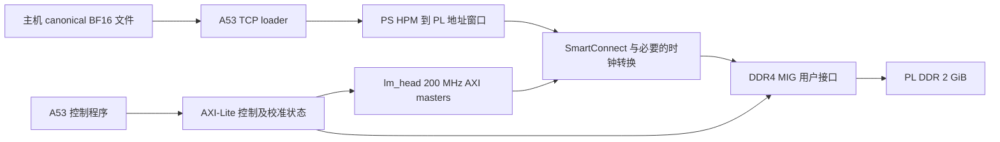
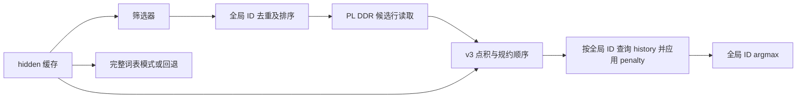

# lm_head v4：PL DDR 与动态候选词表实施规划

## 2026-10-21 执行更新（优先于下方历史规划状态）

- 最新：候选精算HLS/C仿真已通过；独立IP 200MHz OOC内部WNS+0.808ns/WHS+0.010ns，外部I/O/完整BD与板卡尚未验证。
- 初轮holdout99.8464%失败保留；保守配置另用新1000问题/14969decode，1次漏选，99.9933%，达到拟议点估计门槛，非无损或发布验收。
- 当前26项host测试PASS；G:2021.1工具已恢复。用户继续后推进top-K/并集HLS；下方首次采集/无质量状态为当日较早检查点。
- 完整证据见`../module_14_lm_head_v4/reports/OFFLINE_STAGE_RESULT_20261021.md`与JSON，候选契约见`../module_14_lm_head_v4/HLS_CANDIDATE.md`。
- 用户要求继续本规划；P1 已由 **lm_head v3.1** 完成真实板测和正式交付，不重建、不改封存资产。
  基线 IP median/P95=117.751830/117.752020ms，等效 lm_head 吞吐约8.49 token/s；整体 LLM decode/TTFT 未测。
- 当前在独立 `module_14_lm_head_v4/` 推进 P2/P3 离线阶段；不操作板卡、不恢复旧 wb/心跳。
- 候选精算 CPU 契约、8项单元测试、8步×6类共48组真实候选/全表数值对照通过；这不代表HLS或板测通过。
- 用户选择公开可复现语料；已下载固定作者版本，训练1500、校准320、holdout1000条，来源及SHA见
  `../module_14_lm_head_v4/data/public_corpus_v1/sources.lock.json`，划分和重复检查见同目录MANIFEST.json。
- 本机RTX5060 Laptop / 系统Python3.12有CUDA PyTorch/Transformers；完整权重与Qwen作者ModelScope SHA一致，tokenizer旧36-token输入验证通过。
  GPU逐位head已对8步完整logits SHA验证通过；已开始正式hidden标签采集，每prompt最多16步并逐条留恢复点。
- 当前尚无 selector 质量结论、v4硬件身份或稀疏性能；后续按校准选型、holdout复核，再进入HLS/实现。
- 上游直供“权重”继续等待负责人框架；不改成其他传输对象、不冻结外部流接口。
- 实际状态以 `../module_14_lm_head_v4/PROGRESS.json` 及报告/采集日志为准；下文2026-10-19的未实施/板卡占用描述为历史。

日期：2026-10-19。状态：规划完成，尚未实施 v4 内核、构建 v4 镜像或进行 v4 板测。

执行更新（2026-10-19）：用户已将 P1“PL DDR 完整词表迁移”单独命名为 **lm_head v3.1**，
要求通过 luyou 派发 workbuddy 实施并上板验收；用户另已确认板卡释放、可由 wb 独占。
因此本文件内原“禁止板卡/等待新安排”描述保留为规划时状态，当前 v3.1 以
[执行任务书](tasks/LM_HEAD_V3_1_PL_DDR_WB_20261019.md)及根 AGENTS.md 顶部最新安排为准。
稀疏化与上游直接提供权重仍属于后续 v4 范围。

## 1. 目标、范围与工作边界

用户确定的 v4 方向：

1. lm_head 数据存储从 PS DDR 迁至 PL DDR。
2. 采用动态候选词表稀疏化，减少实际读取和精算的权重行。
3. 后续由上一个模块直接提供权重，不经过 DDR；该项依赖项目总负责人更新整体框架并下发文档，本轮不实现。

本轮先规划独立 M14，不扩展公共 ABI、原生 M06 或整体 LLM 集成。原 v3 已验收源码、报告和交付包保持不变。建议后续实现使用独立 `module_14_lm_head_v4/`，新 IP 身份、build_config、能力字段和 package profile 在实施时分配，不能继续冒用 v3 的身份。

**当前禁止任何板卡操作**：板卡由另一个 agent 使用。离线源码、仿真、综合、实现及文档工作可在各自前置条件满足后开展；本次请求只形成规划。JTAG、网络探测、加载、校准和硬件验收均等用户重新明确安排板卡后执行，不能把本计划中的未来板测步骤视为当前授权。

“不使用 PS DDR”的范围已由用户于 2026-10-19 明确确认：lm_head 的权重、hidden、history、logits、候选表和筛选参数全部放 PL DDR；A53 程序、栈、堆、TCP 接收暂存和主机 mailbox 仍可使用 PS DDR，计算内核不从 PS DDR 读取这些计算数据。本轮不包含 PS 软件运行内存迁移或完全禁用 PS DDR。

第三项按用户原文记录为“上游提供权重”。当前常规链路中，上游输出的是 hidden，lm_head 使用固定权重；待总负责人文件明确传输对象、布局、生命周期、带宽和握手后再实施，不自行将“权重”改成“hidden”，也不提前冻结 AXI-Stream 协议。

## 2. 已核实的起点与未核实依赖

| 项目 | 当前事实 / 约束 | 依据 |
| --- | --- | --- |
| v3 数值 | BF16 权重及输入、FP32 计算；词表 151936，hidden 896 | [v3 正式源码](../module_14_lm_head_v2/experiments/board200_20261019/src/lm_head_v2.cpp)、[头文件](../module_14_lm_head_v2/experiments/board200_20261019/include/lm_head_v2.hpp) |
| v3 性能 | 200 MHz；IP median/P95 为 117.751805/117.751890 ms | [同板实测对比](../module_14_lm_head_v2/reports/board200_20261019/comparison.json) |
| v3 数据路径 | 四路 HLS AXI master 经 SmartConnect 到 PS HP2，未实例化 PL DDR MIG | [硬件 profile](../deliverables/20261019_M14_V3_r1/M14_V3_20261019_r1/module_14_lm_head_v3/interface/hardware_profile_summary.json) |
| PL DDR 板级记录 | 2 GiB，32 bit 物理 DQ；200 MHz 差分参考输入 | [参数说明书 §2.5](0924/PS_PL%20全模块参数与接口字段说明书.md) |
| 历史 MIG 工程记录 | AXI 128 bit、地址 31 bit、UI 266.5 MHz；仅为旧工程配置，不是 v4 已验证配置 | 同上；[架构计划末尾板级补充](0924/PS_PL%20全模块架构、详细设计与统一集成实施计划.md) |
| 历史工程路径 | 说明书引用的 `D:/FPGA_PRO/llme_SDWeight_proj/rmsnorm_axu9egkv_gqa_lmhead/rmsnorm_axu9eg.srcs/sources_1/bd/system_wrapper/system_wrapper.bd` 本次本地检查不存在 | 2026-10-19 本地文件检查；需恢复可复用 XCI/XDC 或从板卡资料重建 |
| 稀疏算法依据 | 动态筛选候选 ID 后，只对原始权重候选行精算；本项目尚无候选召回和加速实测 | [本地文献梳理](paper/lm_head_sparse_vocabulary/README.md) |
| 现有 trace | prefill 加 7 个 decode 步，可做格式与数值冒烟 | [Python reference](../qwen25_0p5b_python_reference/README.md) |

文献 README 的基线章节仍写“200 MHz 尚未板测”，这是历史状态；本规划采用 2026-10-19 已验收的 v3 数据。文献结果不当作当前 FPGA 的性能或质量结果。

## 3. 实施顺序与阶段产物

先拆开存储迁移和算法变化，再合并。PL DDR 准备期间可以开展软件筛选实验；这是工作依赖安排，不要求启动多个 agent。

| 阶段 | 主要工作 | 产物 | 通过条件 |
| --- | --- | --- | --- |
| P0：冻结基线与依赖 | 固定 v3 SHA、软件语义、板级资料和评估口径；按已确认的 PS/PL DDR 范围落实布局 | `BASELINE.json`、板级资料清单、待决事项 | 能复现基线；MIG 型号、引脚、参考时钟来源明确 |
| P1：PL DDR 完整词表版本 | 新 BD/MIG、CDC/复位、地址映射、loader；保持原数学路径 | dense-PL-DDR 源码、约束、构建脚本、硬件 profile、仿真和实现报告 | 离线检查通过；待板卡授权后完成内存与 dense 数值验收 |
| P2：软件动态筛选实验 | 建立独立语料，比较路由与低秩筛选，形成质量—字节—时间曲线 | 数据清单、selector 参数、候选集、质量报告 | 存在质量可接受且总成本有收益的候选方案；未通过则调参或保持 dense |
| P3：候选行读取与精算 | 先接外部给定候选 ID，验证 gather、全局 ID、penalty、tie-break | sparse 精算核、C/RTL 测试、候选输出格式 | 候选行 FP32 结果逐位一致；全候选时与 dense 完全一致 |
| P4：筛选器与稀疏核组合 | 接入 P2 入选筛选器，计入其实际运行位置和全部开销 | 独立 v4 候选镜像、完整报告 | 200 MHz 完整实现时序通过；满足质量与总性能门槛 |
| P5：板测与交付 | 用户重新安排板卡后做同板 A/B 和稳定性验收 | v4 交付目录、ZIP、SHA、复现步骤、原始证据 | 内存、数值、质量、性能和稳定性分别有明确结果 |

P1 的 dense 数值验收不能被 sparse 结果替代。P2 可独立于板卡推进；只有 P1/P2/P3 分别满足门槛后才合并为正式候选。不能因为 MIG 尚未有板测结果就宣称 PL DDR 通路可用。

## 4. P1：PL DDR 迁移设计

### 4.1 目标拓扑

M14 数据 master 直接访问 MIG，不经 HP2 绕到 PS DDR。A53 通过 HPM 的 PL 映射窗口写入/回读 PL DDR；控制和数据窗口分别配置。软件基址与 MIG 本地偏移可能不同，需明确地址转换和可达区间，不能只把旧 `0x40000000` 换成一个常量。

### 4.2 硬件与地址工作

- 从板卡手册、原理图/可靠 XDC 与旧 XCI 核对存储颗粒、DQ/DQS/地址控制引脚、BANK64/65、时钟引脚和复位。颗粒型号/速度级别在既有文档中有不同写法，必须建立可复核配置。
- 保持 M14 用户逻辑目标 200 MHz；MIG 参考输入、MIG UI 与 M14 时钟分别建模。UI 不是 200 MHz 时，使用经过验证的 AXI 跨时钟路径和每域同步释放复位，完成 CDC/STA 检查；不将 266.5 MHz 旧 UI 数字视为新设计既定值。
- `init_calib_complete`、复位和时钟状态通过独立可读状态路径暴露，设置超时；校准完成前禁止发起 DDR 数据访问。
- 从实际 BD 导出 A53 可见物理窗口、HLS 可见地址、MIG 偏移、容量、AXI/物理位宽、时钟和 burst 限制。检查 HLS 指针、AXI address width、驱动及 loader 均不截断 64 位地址，尤其避免 A53 的大于 4 GiB 地址映射被截成 32 位。
- 生成有范围和重叠检查的本地内存布局：权重、hidden、history、debug logits、候选表、selector 参数、scratch 互不重叠。独立模块的 PL DDR 区域不当作整体工程最终分配；未来 KV cache 等共享使用由总负责人统一安排。

完整 BF16 权重仍保留 272269312 B（259.65625 MiB），加现有输入、history 和完整 debug logits，数据量约 260.256 MiB；另计 selector、索引、scratch 和对齐。稀疏计算不意味着可以立即删除全量权重，因为候选精算和 dense 回退仍需原行。

### 4.3 loader 与 PS 软件

- 复用已修复的 TCP 协议、断线处理和 `tcp_output` 重试；增加显式内存类型、目标窗口、范围/长度检查、profile/镜像身份校验，不允许旧 PS-DDR 包被误当作 PL-DDR 包使用。
- 主机文件 SHA256、每块 **PL DDR 实际回读** CRC32、完整 PL DDR CRC32、首尾 sentinel 全部验证。软件接收缓冲的 CRC 不能代替目标 DDR 回读。
- 为 PL DDR 窗口明确 BSP/MMU 属性、cache 策略、内存屏障及写完成顺序，不能直接照搬普通 PS DDR 缓冲处理。首版可使用便于验证的映射策略；若加载成为瓶颈，再以实测决定批量传输或 DMA。
- 网口仍负责大权重传输；完整镜像切换必须使用配套 bit/XSA/PS init/ELF/profile，不沿用 v3 的 retain-hardware 假设。
- 按用户已确认范围，A53 程序、栈、堆和 TCP 接收暂存可保留 PS DDR。计算路径中不保留隐式 PS-DDR 权重副本或回退读取；加载过程中允许使用 PS DDR 暂存，但目标校验必须针对 PL DDR。

### 4.4 验收

离线：BD 地址与连接检查、MIG 参数/引脚约束、AXI CDC、超时/校准门控、完整设计 5 ns 约束下 setup/hold/pulse-width 和约束覆盖检查。

未来获准板测后：先做 PL DDR 边界/地址线/非对齐拒绝/数据模式读写与 CRC，再测连续读写及 1792 B 行 gather；核对校准和重置恢复。随后在 dense 模式完成原 8 步生产输出及完整 logits 逐位一致、错误路径、至少 30 次独立计时、1000 次连续调用。对比 v3 的 117.751805 ms，并同时报告吞吐、等待/背压和 PS wall 时间。

迁到 PL DDR 的目标是实现数据归属与后续结构准备；容量、物理位宽和总线拓扑不同，**本阶段不预先承诺比 PS DDR 更快**。

## 5. P2：动态候选词表的选型与软件实验

本轮“稀疏化”定义为保留 tokenizer、全局词表和 canonical BF16 原权重，只减少每步实际精算的词表行；先不叠加权重元素剪枝、永久删词或更换输出层训练结构。

### 5.1 首轮比较方案

1. **主要候选：聚类路由。** 参考 L2S/P04，以 hidden 选择少量簇，查候选表，再用原权重精算。先建立可复现的 k-means/候选并集基线；簇数、每簇大小及多簇路由均通过数据选定。
2. **对照方案：低秩预筛。** 参考 P02/P05，先做 SVD 基线，扫描秩 32/64/128；预筛只生成 ID，精算仍走原 BF16 行和原 FP32 顺序。低秩矩阵、投影和 top-K 成本全部计入。
3. **任务限定对照：请求级词表。** 任务常用词、输入词和特殊 token 的并集，单独记录请求构建和打包成本，不能用其固定任务成绩代替通用生成成绩。

K 首轮扫描 2048/4096/8192/16384；聚类路由可先扫描簇数 128/256/512，再依据候选膨胀和资源预算缩小范围。参数是实验网格，不是已验证生产配置。图检索/LSH 暂为后续备选，首轮不同时铺开所有路线。

### 5.2 数据与质量门槛

- 固定模型/tokenizer、canonical 权重 SHA、hidden 的提取位置及 BF16 转换、penalty 与解码语义；先复现 v3 的 8 步 trace。
- 建议首个正式 holdout 至少覆盖 1000 个独立 prompt、10000 个有效预测步，包含中文、英文、代码、数学、罕见词/专名、长上下文和 penalty 触发场景；各类分项单独报告。这是最低评估规模建议，不代表统计上已证明任意域可靠。
- 训练、校准、测试按完整 prompt/来源分割并去重，不能随机拆相邻 token 造成泄漏。现有 8 步仅做冒烟；完整模型/新语料/推理算力的可用性在实施时核查，不在本次规划中启动远程任务或下载。
- 分离两个基准：候选行算术对 v3/其精确软件模型；语料泛化与自由生成对同一完整模型的 dense 解码。普通框架 GEMM 的末位舍入不能自动视为 v3 的逐位 golden。
- 第一指标是 **penalty 后 dense 赢家的 recall@候选集**，同时报告最终 token 一致率、raw top-k 覆盖、候选 score 逐位一致、EOS/控制 token、候选 K 的平均/P95/最大值、首次序列分叉和任务质量。
- 建议算法初筛门槛：holdout 的 penalty 后赢家召回率与 token 一致率均不低于 99.9%，且关键子集单独合格；发布质量阈值和任务退化容忍度在质量曲线形成后由用户确认。99.9% 是拟议指标，不是现有结果，更不是“无损”。即使零失配，也报告样本量和置信区间。
- teacher-forcing 与自由生成均评估。加入 EOS/输入词或扩大 K 可降低风险，但不保证包含惩罚后的赢家；筛选器低置信度触发扩大集合/全扫描，也不构成严格正确性证书。

如用户要求任意输入都与 dense 严格一致，启发式 shortlist 不能满足该承诺；需采用具有有效排除上界的算法，或回到完整扫描。这是后续质量要求的分支，不把高召回率写成严格等价。

## 6. P3/P4：硬件划分与接口语义

先把选择器与精算解耦，先测正确候选行读取，再接入在线选择器。

- **P3 首版使用软件给定候选表**，这是精算核 bring-up 和测量工具；给定候选的时延不能当作自动筛选后的正式 v4 端到端性能。
- 候选路径读取 `weight_base + global_token_id * 1792` 的连续行。每行 112 个 128-bit beat，不能简单把 `vocab_size` 改成 K 后读取权重前 K 行。
- 在读取前去重并按 ID 排序；比较按行 gather 与相邻行段合并，统计实际多读的行和字节。不要为了候选打包而每步先扫描完整原权重。
- 保持 BF16 原行、hidden 和原 FP32 累加/规约次序；候选内每行输出必须与 dense 同行逐位一致。候选行顺序改变，不改变该行内部算术顺序。
- penalty、EOS 和 argmax 使用全局 token ID；显式保持同分时较小全局 ID 获胜。history 在稀疏路径按 `global_id >> 7` 查询，不能继续用候选局部序号；记录块缓存命中和实际读流量。
- 候选表严格检查空集、重复、越界、K/容量和版本。全候选模式应与 dense 一致，作为存储/数值/映射联合回归。
- 稀疏 debug 输出为 `(global_id, raw_FP32_score)`，并标明有效项数/覆盖范围；不能将未计算行补零后冒充完整 logits，不能复用完整 logits CRC 的通过语义。
- 未读取行的 NaN/Inf 无法由 sparse 核运行时发现。加载/离线完整资产校验与 sparse 运行时数值错误范围分别说明；若有运行期内存破坏，跳过行不会被本次精算检查。
- 保留 dense 模式用于调试、回归和回退。增加实际候选数、精算行数、索引/权重/筛选字节、selector/reader/compute 等阶段周期、回退原因等计数，避免把稀疏覆盖误报成全表验收。
- P4 推荐在质量选型后将可行的轻量 selector 放 PL。若第一版使用 A53 selector，必须明确标注，并将 PS 时间、搬运和控制开销计入总时间；PC 预计算只作离线实验工具。
- 对第三项仅在源码内部区分“权重读取”和“算术消费”职责，保留现有 FIFO 边界；不新增外部流端口，不冻结数据包与 backpressure 协议。

## 7. 存储预算与性能计算方法

设 V=151936、d=896，每个 BF16 元素 2 B，则：

`B_dense = V * d * 2 = 272269312 B = 259.65625 MiB`。

`B_exact(K) = K * d * 2 = 1792 * K B`。

| K | 精算行占比 | 精算权重 MiB | 仅精算字节缩减倍数 |
| ---: | ---: | ---: | ---: |
| 2048 | 1.348% | 3.5 | 74.19× |
| 4096 | 2.696% | 7 | 37.09× |
| 8192 | 5.392% | 14 | 18.55× |
| 16384 | 10.783% | 28 | 9.27× |

总流量要加筛选器和索引。例如采用 BF16 路由矩阵、R=256、K=4096、每个 ID 为 32 bit，且每步只读一份路由矩阵和一个候选列表，理想逻辑流量为：

`B_route = 2*R*d + 4*K + 2*K*d = 448 KiB + 16 KiB + 7 MiB = 7.453125 MiB`。

这还不含 hidden/history、路由合并、实际多读、AXI 开销；若路由参数常驻片上则每步 DDR 读取可减少，但消耗片上资源。R=256、每簇固定 4096 个 ID 时，全候选表本体约 4 MiB，也需保存；簇重叠、多簇合并或可变长度会改变预算。不能只看每步 16 KiB。

BF16 低秩预筛按：

`B_LR ≈ 2*d*r + 2*V*r + 2*K*d + 索引及其他元数据`。

K=4096、r=64 时前三项约 25.65625 MiB，相对 dense 的逻辑字节缩减约 10.12×。这些是形状预算，既不是实测带宽，也不是加速倍数。

统一计时边界为 hidden 已可用到最终 token/score 可用：

`T_v4 = 实测的 selector + 候选处理/搬运 + 精算 + 策略 + 调度的完整调用时间`。

该式表示计费范围；存在流水重叠时，以完整调用实测墙钟为准，不能把有重叠的阶段计时直接相加。冷启动权重加载、离线索引训练和每请求打包成本另列，打包成本按真实生成步数摊销，不能隐去。

必须设置三组对照：A=v3 PS-DDR dense；B=v4 PL-DDR dense；C=v4 PL-DDR sparse+在线 selector。分别报告 A/B（存储迁移）、B/C（算法收益）、A/C（整体收益），并使用同一批 hidden/history 和一致时钟/计时边界。

建议性能目标是 C 的端到端 P50/P95 至少优于 B，且整体对 A 有收益；将相对 v3 **至少 2×** 作为探索目标，而非已承诺结果。若 B 比 A 更慢，C 仍须按 A/C 计算最终收益。质量门槛不因加速目标放宽。完整 LLM 加速需另测 head 占比，再用 `S_total = 1/((1-p)+p/S_head)` 估算；本轮不提供未集成系统的加速结论。

## 8. 最终验收与交付要求

| 维度 | dense PL DDR | sparse PL DDR |
| --- | --- | --- |
| 内存正确性 | 校准、范围、CRC/sentinel、读写/错误路径通过 | 另验索引/selector 参数版本、SHA/CRC、实际 gather 地址和字节 |
| 数值正确性 | 原 8 步完整 logits 与生产结果逐位一致 | 候选行逐位一致；K=V 全候选等价；ID/penalty/tie-break 通过 |
| 算法质量 | 作为全表基准 | 独立 holdout 与自由生成；报告漏选、分叉及分项结果 |
| 实现 | 200 MHz 全 BD 时序/CDC/约束检查通过 | 合并 selector 后重新完整检查，资源含 MIG/互连/selector |
| 性能 | 至少 30 次独立调用，median/P95/max 与字节/周期 | 代表性语料覆盖 K/回退分布，含 selector 的同边界 A/B；小样本和大样本分别报告 |
| 稳定性 | 至少 1000 次连续调用 | 至少 1000 次连续调用，覆盖候选大小和回退；不将固定单例循环当作算法泛化测试 |

最终交付：独立源码/头文件/驱动、MIG 与板级约束、构建和 TCP 加载脚本、bit/XSA/PS init/ELF/profile、selector 训练/导出与索引版本、可复现的语料划分清单与评估脚本、dense/sparse 验收报告及原始证据、SHA256SUMS 和 ZIP 校验。

发布说明明确 v4 是近似候选模式还是具备严格等价保证，默认模式/回退条件、适用语料、质量阈值和未覆盖能力。v3 作为可复现的已验收基线继续保留。

## 9. 下一步可执行的小阶段

1. 按已确认的计算数据迁移范围，本地整理可用 MIG/XDC/原理图和旧工程恢复来源，形成板级配置差异表。
2. 建立 v4 独立目录与基线 manifest，设计 PL DDR 地址/profile 草案及 loader 变更清单；不复用 v3 的镜像身份。
3. 用现有 8 步实现候选 ID/原行精算的软件冒烟，并形成新增语料与 full-head 标签采集方案。完整模型和本地算力核实后再启动大规模采集。
4. 完成 P1/P2 的离线产物后报告可审阅结果；板卡仍保持不操作，待用户重新明确安排后进入硬件验收。

PS 内存范围已确认。工期在 MIG 资料恢复及质量数据可用性明确后估算；这两项依赖尚未满足，不能承诺以几天完成整个 v4。
