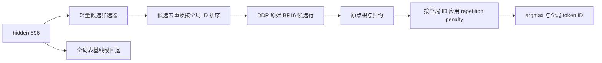

# LM Head 动态候选词表与访存优化：论文梳理

检索与整理日期：2026-10-19。对象：Qwen2.5-0.5B 的独立 FPGA M14 LM Head。目录收录 **12 篇未经改写的英文原文 PDF**，优先采用会议官网、ACL Anthology、PMLR 或作者 arXiv 版本。本次是定向文献调研，不是穷尽检索，也没有修改内核、加载权重或操作板卡。

## 1. 结论与阅读顺序

**有成熟的研究路线，用户提出的“15 万词表中每次只算几千词”通常称为 dynamic vocabulary selection / vocabulary screening / approximate top-k output projection。** 核心是在读取完整输出权重之前，以较低成本产生候选 token ID，只对候选行做完整点积。它与本项目目标直接相关。

建议先读 **P01 Learning to Screen → P02 HiRE → P03 VocabTailor → P04 Fast Vocabulary Projection**。前两篇回答“怎样便宜地找候选”，P03 回答“如何按任务/输入加载词表”，P04 提供 Transformer 上的工程经验。P05 SVD-Softmax 是无需重训原模型的低秩预筛基线；P06/P07 是图检索、哈希检索的对照。

对当前项目，建议先比较两个独立软件原型：

1. **逐 token 动态筛选**：hidden → 小规模聚类路由或低秩预筛 → 候选 ID → 原 BF16 权重精算 → 原 penalty / argmax。面向通用生成，最贴近原始设想。
2. **逐请求收缩词表**：任务常用词集合 ∪ 输入 token 集合 ∪ 必需特殊 token，生成期间复用候选权重。工程简单，适合任务固定场景，但不能据此假定开放域中文生成也只需几千词。

这些建议是结合论文与本项目作出的工程判断，尚未在本项目测得准确率、流量或加速。

## 2. 项目基线与问题边界

核对本地源码及已有验收记录后：

| 项目 | 已核实情况 | 本地依据 |
| --- | --- | --- |
| 词表/hidden | `151936 × 896` | [lm_head_v2.hpp](../../../module_14_lm_head_v2/include/lm_head_v2.hpp) |
| 权重类型/规模 | canonical BF16；272,269,312 bytes = 259.65625 MiB | 同上及交接记录 |
| 生产 V2 | 100 MHz，完整词表 Decode/penalty-ON 板测通过；IP median/P95 均为 224.868020 ms | [交接文档](../../LM_HEAD_V2_HANDOFF_20261009.md) 中 2026-10-10 验收更新 |
| 升频探索 | 目标为 **200 MHz**；RTL与完整单模块 BD 布局布线时序通过，尚未完成 200 MHz 板测 | [200 MHz RESULT](../../../module_14_lm_head_v2/reports/frequency_200_20261016/reduce_layers/RESULT.md) |
| 当前取词流程 | 全表顺序读取 → BF16 转 FP32 点积/归约 → repetition penalty → argmax；可选写 raw logits | [lm_head_v2.cpp](../../../module_14_lm_head_v2/src/lm_head_v2.cpp)，`read_weight_stream`、`policy_and_argmax` |

用户所说的“200Hz版本”在工程中对应 200 MHz 探索分支。稀疏词表是另一条可独立评估的算法路线；升频通过并不意味着它的精度风险已被验证。

需要区分三件事：

- **本方向**：保持 tokenizer 与完整词表定义，动态跳过不太可能被选中的输出权重行。
- **普通 top-k/top-p 采样**：通常先算完所有 logits 再过滤，不能减少这次全表权重读取。当前生产 V2 已用在线 argmax，省去 softmax 指数/归一化不是这里的主要机会。
- **永久删词或更换输出层结构**：可能需要改 tokenizer、embedding、模型训练或蒸馏，属于另一种精度/兼容性代价。候选集输出也不能自动保留完整概率分布。

## 3. 路线对比

| 路线 | 候选由什么决定 | 完整原权重读取范围 | 额外代价 | 对当前 FPGA 的判断 |
| --- | --- | --- | --- | --- |
| L2S / 聚类路由（P01/P04） | 当前 hidden 与少量中心/路由向量 | 候选行 | 采集 hidden、训练路由、候选表；簇大小不均 | 首选之一；候选表可排序，访存较易规划 |
| 低秩/量化预筛（P02/P05） | 压缩输出矩阵近似 logits | 候选行，另需读压缩筛选矩阵 | 全词表的低维/低 bit 扫描、top-K | 首选基线；易算总流量，不能漏算预筛成本 |
| 请求级混合词表（P03） | 任务静态集合与本次输入 | 请求词表行 | 预加载/打包及 token 映射 | 任务固定时有吸引力；更新成本可跨生成步摊销 |
| 图 MIPS（P06/P11） | hidden 导航词向量索引 | 检索访问的行/精排行 | 图邻接表、随机访存、数据依赖 | 算法代表性强，DDR 访问与流水控制较复杂 |
| LSH（P07） | hidden/词向量的哈希签名 | 入选行 | 签名扫描或桶索引、召回调参 | 位运算适合 FPGA，但需统计索引流量及读取效率 |
| Early-exit / draft 裁剪（P08/P09） | 中间层预测/草稿统计 | 特定架构内的小词表 | early-exit 或 target 验证机制 | 可借鉴，不能直接套用其无损性或收益 |
| Adaptive softmax（P12） | 训练好的层次/簇分布 | 按新结构执行 | 输出参数化变化、通常需重训 | 背景阅读，非现有 canonical BF16 head 的直接替换 |

“只精算 K 行”不等于“系统只读 K 行”：检索阶段也可能读向量、签名、路由权重或索引。

## 4. 代表论文逐篇笔记

下面的性能数字均为**原论文的指定任务、模型、硬件与指标**，不是当前 FPGA 实测。页码按本目录 PDF 的物理页计。

### P01 · Learning to Screen（L2S）

**Patrick H. Chen 等，ICLR 2019；本地保存 arXiv:1810.12406v1（2018 预印本），13 页。**

[官方条目](https://openreview.net/forum?id=ByeMB3Act7) · [作者原文](https://arxiv.org/abs/1810.12406) · [本地 PDF](2019_ICLR_Learning_to_Screen.pdf)

将 hidden/context 分簇，每个簇关联候选词集合。在线先用轻量路由选择簇，再对集合做完整输出计算；借助 Gumbel-softmax 学习路由及候选集合。推理复杂度由 `O(Vd)` 变为约 `O((R+K)d)`。原文 Table 1 的德英翻译约 25K 词表上，输出层预测为 20.4×，precision@1 为 98.9%；它衡量与完整输出的预测一致性，不等于任务正确率或端到端加速。重点读 §3、Table 1/2（PDF 第 4–9 页）。对本项目最有价值的是“路由很小、候选集合预存”的结构；需用 Qwen hidden 校准，不能沿用论文候选表。

### P02 · HiRE: High Recall Approximate Top-k Estimation for Efficient LLM Inference

**Yashas Samaga B L 等，arXiv:2402.09360v1，2024，14 页。**

[作者条目](https://arxiv.org/abs/2402.09360) · [本地 PDF](2024_HiRE_2402.09360v1.pdf)

先以低秩（HiRE-LR）、int4（HiRE-Q）或二者组合估计较大的 top-k′，再以原参数精算。强调候选高召回与真实 gather 成本。Table 1 仅改 softmax 的模型，端到端最高约 1.22×；摘要的 1.47× 是 softmax 与 FFN 共同优化，不能算作 lm_head 单独收益。§3.2–3.3、Table 1/2/4（PDF 第 4–8 页）最相关。量化筛选可后处理；论文的高质量低秩方案还涉及学习/蒸馏。当前项目可只借用筛选器，精算仍保留原始 BF16 行及原加法树。

### P03 · VocabTailor: Dynamic Vocabulary Selection for Downstream Tasks in Small Language Models

**Hanling Zhang 等，Findings of ACL 2026，19 页；首次预印本 2025（arXiv:2508.15229）。**

[会议条目](https://aclanthology.org/2026.findings-acl.1418/) · [本地 PDF](2026_Findings_ACL_VocabTailor.pdf) · [作者代码](https://github.com/AwakenedInsects/VocabTailor)

将 embedding 与 LM head 分开处理，输出词表采用“任务静态词 ∪ 当前输入词”；主要在**每个请求开始时**构建，不是每生成一个 token 预测新集合。§3、Table 1/2 与 Appendix A 说明按需加载、PreAlloc 及其代价。Table 1 的代码任务使用约 3,579 词、Pass@1 54.10%→53.87%，而 Qwen3 英译中仍约需 18,914 词。Table 2 的 A100 TPOT 为 24.21→24.30 ms，说明显存节省不必然带来延迟收益。可启发 FPGA 的请求级候选权重打包，但不能把“最多约 99% 节省”解释为开放生成每步都能无损压到几千词。

### P04 · Fast Vocabulary Projection Method via Clustering for Multilingual Machine Translation on GPU

**Hossam Amer 等，AMTA 2022，12 页。**

[会议条目](https://aclanthology.org/2022.amta-research.5/) · [本地 PDF](2022_AMTA_Fast_Vocabulary_Projection.pdf)

从预训练 Transformer 收集 hidden 与其 top-K 输出，用 k-means 聚类；每簇候选词是成员 top-K 的并集。在线选簇、取候选，再计算投影。batch/beam 情况采用集合合并来保持 GPU 运算规模。原文报告投影步骤最高 2.6×、端到端速度最高提高 25%，需区分两个口径。重点读 §2.2–2.3（PDF 第 3–5 页）与实验。适合本项目先做不改原模型的校准基线；hidden 簇互斥不代表候选词集合互斥，硬件存储重排时不能假定每个词只属于一个簇。

### P05 · SVD-Softmax: Fast Softmax Approximation on Large Vocabulary Neural Networks

**Kyuhong Shim 等，NIPS 2017，11 页。**

[会议条目](https://papers.neurips.cc/paper_files/paper/2017/hash/4e2a6330465c8ffcaa696a5a16639176-Abstract.html) · [本地 PDF](2017_NIPS_SVD_Softmax.pdf)

离线 SVD，在线先以少量主成分扫描全词表形成 preview，再为较少候选补充完整维度。原文 800K 词表案例约需完整方案 20% 的运算，GPU 超过 3×；这不是 DDR 流量实测。重点读 Figure 1、Algorithm 1 与 §3（PDF 第 3–4 页）。无需重新训练原模型，适合作为低秩筛选起点。不过原论文在变换空间补算；为保持本项目逐位算术，应将其只用于选 ID，再读取 canonical BF16 原行精算。该改法需独立验证，不能继承论文数值结论。

### P06 · Navigating with Graph Representations for Fast and Scalable Decoding of Neural Language Models（FGD）

**Minjia Zhang 等，NeurIPS 2018，12 页。**

[会议条目](https://papers.neurips.cc/paper_files/paper/2018/hash/366f0bc7bd1d4bf414073cabbadfdfcd-Abstract.html) · [本地 PDF](2018_NeurIPS_Fast_Graph_Decoder.pdf)

离线对输出向量作保持内积排序的变换并建 small-world graph；在线用 hidden 搜索高分词。原文在语言建模/翻译的输出解码中报告量级加速。重点读 §3、Figure 1 和 IPPT（PDF 第 3–5 页）。它说明完整 `Wh` 可以变成检索问题；但图导航仍需读取访问节点的向量和邻接表，并有串行依赖。FPGA 必须计入这些随机访问，不能用返回候选数量代表总读取行数；也不应将论文近似质量保证解释为任意输入 top-1 严格一致。

### P07 · Revisiting Locality Sensitive Hashing for Vocabulary Selection in Fast Neural Machine Translation

**Hieu Hoang 等，WMT 2022，15 页。**

[会议条目](https://aclanthology.org/2022.wmt-1.79/) · [本地 PDF](2022_WMT_LSH_Vocabulary_Selection.pdf)

研究 LSH 筛词及翻译速度/搜索误差，讨论输出 bias 与训练方式的影响。最终训练/蒸馏配置报告翻译速度最高提高 87%，并明确评估相对于完整解码的搜索误差。重点看方法、§5.1、Table 8 和附录配置（如 k=1024、哈希数 c=2048）。这些是论文配置，不能当作本项目建议值。当前 head 无输出 bias，减少一个迁移障碍，但 Qwen 向量范数、中文/代码与 penalty 仍需验证。签名矩阵和汉明距离选择可适合 FPGA，代价是额外存储与筛选流量。

### P08 · Dynamic Vocabulary Pruning in Early-Exit LLMs

**Jort Vincenti 等，NeurIPS 2024 ENLSP Workshop；arXiv:2410.18952v2，7 页。**

[作者条目](https://arxiv.org/abs/2410.18952) · [本地 PDF](2024_Dynamic_Vocabulary_Pruning_2410.18952v2.pdf)

在较早层先计算完整词表，按 top-K 裁剪后续多个 exit 的词表，降低重复置信度计算。重点看 §3、Figure 1（PDF 第 2–3 页）。它是逐 token 动态裁剪的直接案例，但收益依赖一次前向中有多个 LM-head/exit 调用。当前 M14 只在末端调用一次 head；若为了选候选额外增加一次全词表扫描，就没有减少总权重读取。也不能将经过 early-exit 微调模型的中间层收敛现象直接用于原始 Qwen。

### P09 · VOCABTRIM: Vocabulary Pruning for Efficient Speculative Decoding in LLMs

**Raghavv Goel 等，arXiv:2506.22694v2，2025，8 页。**

[作者条目](https://arxiv.org/abs/2506.22694) · [本地 PDF](2025_VocabTrim_2506.22694v2.pdf)

统计 target 常生成的 token，对 draft head 作免训练词表裁剪；减少草稿阶段的访存与延迟，代价是接受率可能下降。其特定 Llama-3.2-3B-Instruct/Spec-Bench 案例报告 memory-bound speed-up 指标改善 16%，不是当前 lm_head 的直接加速。重点读方法及实验口径。这里完整 target 仍做验证，所以草稿裁剪的容错能力不同于直接裁剪最终 head；本项目目前没有该验证机制，不能照搬“无损生成”表述。

### P10 · Vocabulary Selection Strategies for Neural Machine Translation

**Gurvan L'Hostis、David Grangier、Michael Auli，arXiv:1610.00072v1，2016，9 页。**

[作者条目](https://arxiv.org/abs/1610.00072) · [本地 PDF](2016_Vocabulary_Selection_Strategies_1610.00072v1.pdf)

代表性的早期输入/上下文候选词表研究，比较上下文及 embedding 筛选，并讨论速度与翻译质量的折中。指定 WMT 任务上 CPU 解码时间最多下降 90%；它既不是 FPGA 数据，也不是所有生成任务上的保证。适合了解“按输入构建 shortlist”的历史基础。本项目可借鉴输入词、任务词的组合，但没有 NMT 双语对齐资源时，需要换成模型输出或本地语料校准。

### P11 · Learning and Inference via Maximum Inner Product Search

**Stephen Mussmann、Stefano Ermon，ICML 2016，10 页。**

[会议条目](https://proceedings.mlr.press/v48/mussmann16.html) · [本地 PDF](2016_ICML_Learning_Inference_MIPS.pdf)

建立大输出空间概率推断与 MIPS 的联系，研究配分函数估计及采样的近似方法。重点读 §3 与误差分析（PDF 第 4–6 页）。它为“输出层可以按检索设计”提供理论背景；不仅是简单 top-1 工程实现。当前 greedy argmax 不必估计归一化常数；若未来扩展随机采样，则要另外评估近似分布，不能将候选内 softmax 当作原完整 softmax。

### P12 · Efficient softmax approximation for GPUs（Adaptive Softmax）

**Édouard Grave 等，ICML 2017，9 页。**

[会议条目](https://proceedings.mlr.press/v70/grave17a.html) · [本地 PDF](2017_ICML_Adaptive_Softmax.pdf)

依据词频分布构建 shortlist 与尾部簇，并调整尾部表示维度，重点优化大词表训练计算。阅读结构与 GPU 成本分析，理解其与后处理筛选的区别。它改变输出层参数化，通常需要重新训练，不能直接裁几行就保留现有 canonical BF16 head 的 logits；求已知词概率与寻找全局 top-k 的复杂度也不能混为一谈。因此仅列为结构性替代方案的背景。

## 5. 针对本项目的访存预算

以下全部是按形状计算的**逻辑权重字节预算**，假设每步读取一次所需权重、不计缓存命中。不是 AXI 事务实测，也不是延迟预测。BF16 每行 `896 × 2 = 1792 bytes`，即 112 个 128-bit beat。

| 精算候选 K | 全词表比例 | BF16 精算权重 | MiB | 相对全表的精算字节缩减倍数 |
| ---: | ---: | ---: | ---: | ---: |
| 151,936 | 100% | 272,269,312 B | 259.65625 | 1.00× |
| 2,048 | 1.348% | 3,670,016 B | 3.5 | 74.19× |
| 4,096 | 2.696% | 7,340,032 B | 7 | 37.09× |
| 8,192 | 5.392% | 14,680,064 B | 14 | 18.55× |
| 16,384 | 10.783% | 29,360,128 B | 28 | 9.27× |

### 5.1 预筛不能免费

若用 BF16 低秩筛选器，秩为 r，并保留完整原权重用于精算，粗略每步流量为：

`B ≈ 2×d×r + 2×V×r + 2×K×d + 索引/元数据`。

以 K=4096 为例：r=32 / 64 / 128 时，前三项分别为 **16.328 / 25.656 / 44.313 MiB**，相对全表约 **15.90× / 10.12× / 5.86×** 的逻辑字节缩减；不是 37×。这里尚不含 top-K、排序和不连续访问的开销，也没有证明这些秩能达到所需召回。

若用全矩阵 int4 预筛，仅 int4 矩阵就有 **68,067,328 B**，加 K=4096 的 BF16 精算后，字节预算缩减只有约 **3.61×**，还未计 scale/zero-point。它可以有收益，但与“只读几 MB”不同。

若用 R=256 的 BF16 聚类路由，路由矩阵约 **448 KiB**；K=4096 时，32-bit 候选 ID 表为 **16 KiB**。但全体簇的候选表、候选重叠、特殊 token、排序与索引存放位置仍需计入。候选权重本体 7 MiB 也不能假定全驻片上。

### 5.2 不把访存缩减直接写成时延收益

建议分别测量 `T筛选 + T候选处理 + T精算 + T策略 + T控制`；流水并行后以实测关键路径为准。现有内核包含点积、归约和 backpressure，224.868 ms 并非纯 DDR 传输时间。稀疏访问可能降低突发效率，因此需要观察真实总线事务和每行有效带宽。

对完整 LLM，只有在测得 head 占总耗时比例 p 后，才可用 Amdahl 估计：`S总 = 1 / ((1-p) + p/Shead)`。本仓库的独立 head 耗时不能充当 p。

## 6. FPGA 迁移的关键约束

1. **候选必须在权重读取之前生效。** 先全表流过再丢弃 logits，或单纯关闭 `write_logits`，都没有实现本方向。现有 `read_weight_stream` 是全表连续流，需要新增候选地址读取路径；只把 `vocab_size` 设为 K 会读前 K 行，不能表示任意 K 个 token。
2. **原行精算与全局等价是两个条件。** 使用原 BF16 权重、相同 hidden、相同 FP32 配对/舍入次序，可保持被选行的数值；要与全表 argmax 相同，还要求候选覆盖惩罚后的真正赢家。先只在软件模拟筛选，不改生产数据格式。
3. **penalty-aware 召回。** 当前 penalty≥1，seen token 的正/负 logits 分别除/乘 penalty，赢家可能改变。预筛应考虑近似分数的同一策略，并在完整基线上统计“penalty 后赢家是否入选”。加入历史词或扩大 raw top-K 只是启发式，不能保证不漏掉惩罚后胜出的其他词。
4. **全局 ID 与 tie-break。** 候选局部行号必须映射回原 token ID，history bitmap 用原 ID 查询。现有顺序扫描遇到分数相同保留较小 ID；重排后需显式保持该规则。候选要检查越界、重复、空集，并保留 EOS/控制 token。
5. **保留长突发并统计实际多读。** 先按原 ID 排序，每个候选仍有 1792 B 的连续行。可比较单行读取与相邻行段合并、固定块选择；若扩大到整块，K 必须按实际读到的行重新计数。簇候选重叠时，物理复制会增加存储且影响共享 embedding 约定。
6. **回退的能力有限。** 不确定时全表回退或扩大集合可降低风险；筛选器置信度不是“未漏词”的证明。若要求任意输入严格等价，应另研带有效上界的剪枝/检索证书或保留全扫描，不能只凭高召回率宣称无损。
7. **现有诊断语义需要区分。** 稀疏路径不能提供所有未计算行的 raw logits/CRC，也不会发现跳过行中的 NaN/Inf。后续接口需标识稀疏输出范围、实际读行数及全局映射；不能把当前全词表 debug 验收直接视为通过。
8. **prefill 单独评估。** 当前独立模块的末端取词，不等同多行 prefill 或批推理；多个 hidden 的候选并集可能显著膨胀。每请求权重打包要记录预处理时间，避免把它隐藏在模块计时之外。

## 7. 建议的下一轮离线实验

本节是后续方案建议，本次没有实施或启动综合/板测。

### 阶段 A：先验证“几千候选”能否保持质量

- 建立独立实验目录，保留生产 100 MHz 与 200 MHz 隔离候选。固定 tokenizer、模型与 BF16 权重 SHA256、hidden 提取位置、repetition penalty、解码策略和语料划分。
- 当前 8-step trace 只能用于格式/数值冒烟，不能证明泛化；补充中文、英文、代码、数学、罕见词/专名、长对话与重复惩罚触发样本，训练/校准/测试按完整 prompt 分离。
- 比较：固定高频词表；VocabTailor 式任务词∪输入词；P04 式 k-means 路由；P05/P02 式 SVD/学习低秩与 int4 筛选。基线选择器必须在线可算；用全表真 logits 选出最优 K 只能作为 oracle 诊断，不能算有效加速方案。
- 扫描 K=2048/4096/8192/16384，低秩 r=32/64/128，以及路由簇数。聚类候选不必固定等长；记录平均/P95/最大集合和合并/补词后的实际 K。
- 第一指标是 **penalty 后的 full-head winner recall@K**，同时报告 raw top-1/top-k 覆盖、penalty 后最终 token 一致率、候选内 score 逐位一致、首次序列分叉位置及任务质量。teacher-forcing 与自由生成两种评估都做，后者可发现误差累积。
- 记录筛选耗时、预处理/搬运、候选排序、精算耗时和总字节；不要只测候选 GEMV。以质量—延迟—字节的 Pareto 曲线选型，再讨论阈值；不能预先认定 K=4096 可用。

### 阶段 B：访存原型与硬件门槛

软件评估有可用点后，比较“原权重随机行 gather”与“请求候选权重打包后连续扫描”。分别报告冷/热请求、请求构建成本、K 分布、burst 利用率、总读字节及 selector+head 总 P50/P95。PS 做 selector 时，PS 时间与 PS/PL 通信同样计入。

候选形成与原行精算采用独立路径验证：先 C/RTL 数值和全局 ID/penalty/tie-break，再做物理实现与板测。严格数值基线仍保留完整扫描；稀疏路径的近似精度结果单列。若后续上板，继续遵守根目录 AGENTS.md 的 canonical BF16、TCP loader、CRC/sentinel 要求。

**优先推进的可检验命题**：在真实 Qwen 测试语料上，轻量路由或低秩筛选能否以约 4K–8K 候选覆盖足够多的 penalty 后赢家，并且在计入 selector、索引与不规则 DDR 访问后仍降低总时延。论文支持这是一条合理研究方向，但尚不能给出本项目的答案。

## 8. 原文、来源与复核

| ID | 本地原文 | 保存版本 | 页数 |
| --- | --- | --- | ---: |
| P01 | [L2S](2019_ICLR_Learning_to_Screen.pdf) | arXiv v1；会议为 ICLR 2019 | 13 |
| P02 | [HiRE](2024_HiRE_2402.09360v1.pdf) | arXiv v1 | 14 |
| P03 | [VocabTailor](2026_Findings_ACL_VocabTailor.pdf) | Findings ACL 2026 正式版 | 19 |
| P04 | [Fast Vocabulary Projection](2022_AMTA_Fast_Vocabulary_Projection.pdf) | AMTA 2022 正式版 | 12 |
| P05 | [SVD-Softmax](2017_NIPS_SVD_Softmax.pdf) | NIPS 2017 正式版 | 11 |
| P06 | [FGD](2018_NeurIPS_Fast_Graph_Decoder.pdf) | NeurIPS 2018 正式版 | 12 |
| P07 | [LSH Vocabulary Selection](2022_WMT_LSH_Vocabulary_Selection.pdf) | WMT 2022 正式版 | 15 |
| P08 | [Dynamic Vocabulary Pruning](2024_Dynamic_Vocabulary_Pruning_2410.18952v2.pdf) | arXiv v2；Workshop 工作 | 7 |
| P09 | [VocabTrim](2025_VocabTrim_2506.22694v2.pdf) | arXiv v2 | 8 |
| P10 | [Vocabulary Selection Strategies](2016_Vocabulary_Selection_Strategies_1610.00072v1.pdf) | arXiv v1 | 9 |
| P11 | [MIPS](2016_ICML_Learning_Inference_MIPS.pdf) | ICML 2016 正式版 | 10 |
| P12 | [Adaptive Softmax](2017_ICML_Adaptive_Softmax.pdf) | ICML 2017 正式版 | 9 |

- [catalog.json](catalog.json)：作者、标题、发表信息、原文 URL 与保存版本。
- [manifest.json](manifest.json)：实际下载 URL、UTC 时间、字节数、SHA256、页数与标题/全页文本提取校验。
- [sources.bib](sources.bib)：按本目录实际保存版本生成的简明 BibTeX，P01 区分 2018 预印本与 2019 会议。
- [download_papers.py](download_papers.py)：下载/本地复核脚本；依赖 Python 与 `pypdf`，已有原文不覆盖。`python download_papers.py --verify-only` 无需联网。

P01 的 OpenReview 下载端点返回 HTTP 403，因此保存作者公开的 arXiv v1，未冒称会议终版。P03 使用正式会议版，其图像对象含重复 `/Group` 字段；容错解析可提取全部 19 页，封面已渲染核对，原文件字节未修复/重写。原文不附翻译、不去水印、不裁剪；版权和许可随各来源原文，下载副本不意味着本项目取得重新授权。SHA256 用于本地后续完整性复核，不是来源方提供的签名认证。
